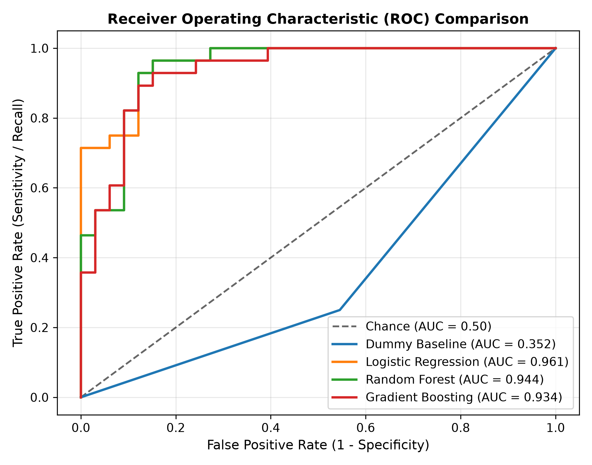
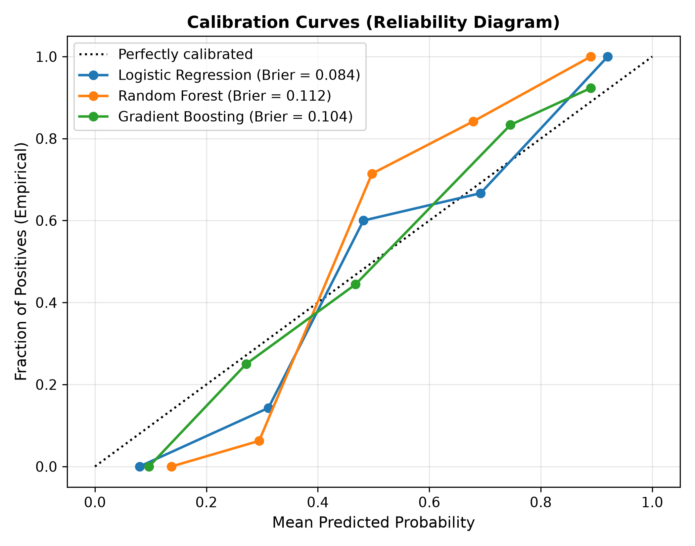
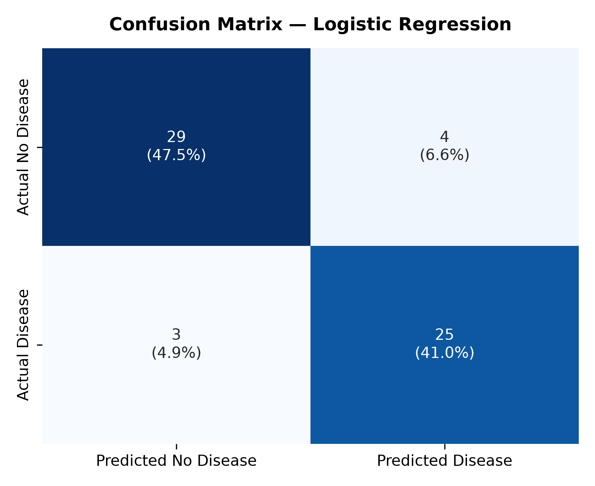
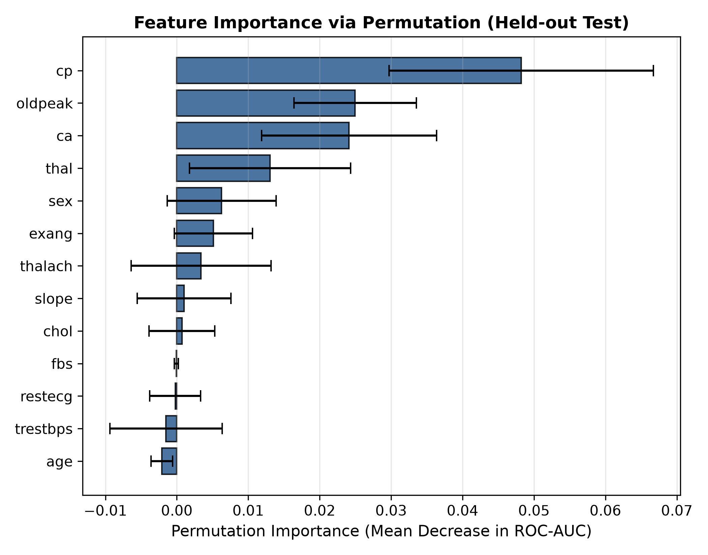

# Heart Disease Risk Classification & Probability Calibration

[](https://share.streamlit.io/)
[](https://www.python.org/)
[](https://scikit-learn.org/)
[](tests/)
[](LICENSE)
[](https://archive.ics.uci.edu/dataset/45/heart+disease)

An end-to-end clinical machine learning pipeline and interactive Streamlit web application that diagnoses angiographic coronary artery disease (CAD) risk while strictly preventing data leakage and ensuring probability calibration.

> **Clinical Research Disclaimer**: This software is strictly for educational, scientific research, and portfolio demonstration purposes. It is **NOT** a certified medical diagnostic device or clinical decision support system. Direct medical decisions must be made by qualified healthcare professionals based on formal clinical evaluation.

---

## Executive Summary & Core Results

In cardiovascular screening, clinical adoption hinges not just on accuracy, but on two vital medical realities:
1. **Minimizing False Negatives (High Sensitivity):** Missing an undiagnosed ischemic patient can lead to sudden coronary events. Our pipeline achieves **89.3% Recall (Sensitivity)** on unseen holdout test data ($25/28$ positive patients caught).
2. **Reliable Probability Calibration (Low Brier Score):** Binary 0/1 outputs are dangerous in medicine; clinicians need trustworthy probabilities. A patient with a predicted $70\%$ risk should have a true event frequency near $70\%$. Our L2-regularized Logistic Regression achieves an exceptional **Brier score of 0.084** and **ROC-AUC of 0.961**.

```
[ Raw Patient Vitals & Cardiac Diagnostics (14 Features) ]
                         │
                         ▼
┌────────────────────────────────────────────────────────┐
│  Zero-Leakage Preprocessing Pipeline (ColumnTransformer)│
│  - Numeric: Median Imputation + StandardScaler         │
│  - Categorical: Mode Imputation + OneHotEncoder        │
│  * Imputation & scaling learned STRICTLY on train fold *│
└────────────────────────┬───────────────────────────────┘
                         │
        ┌────────────────┴────────────────┐
        ▼                                 ▼
[ Calibrated Probabilities ]      [ Feature Attribution ]
  - Brier Score: 0.084              - Fluoroscopy vessels (`ca`)
  - ROC-AUC: 0.961                  - Thallium scintigraphy (`thal`)
  - Holdout Recall: 89.3%           - ST depression (`oldpeak`)
```

---

## Evaluation & Benchmark Results

### 1. 5-Fold Stratified Cross-Validation (Training Cohort, $N = 242$)
Evaluated across 5 folds with stratified sampling to preserve class prevalence:

| Model Pipeline | CV ROC-AUC | CV F1-Score | CV Recall (Sensitivity) | CV Precision |
| :--- | :---: | :---: | :---: | :---: |
| **Dummy Baseline (Stratified)** | $0.515 \pm 0.077$ | $0.433 \pm 0.093$ | $0.396 \pm 0.084$ | $0.478 \pm 0.105$ |
| **Logistic Regression (L2, $C=0.1$)** | **$0.900 \pm 0.016$** | **$0.815 \pm 0.014$** | **$0.792 \pm 0.063$** | **$0.850 \pm 0.076$** |
| **Random Forest (depth=4)** | $0.881 \pm 0.027$ | $0.771 \pm 0.014$ | $0.729 \pm 0.043$ | $0.825 \pm 0.060$ |
| **Gradient Boosting (lr=0.05)** | $0.858 \pm 0.023$ | $0.747 \pm 0.048$ | $0.720 \pm 0.055$ | $0.776 \pm 0.042$ |

### 2. Unbiased Holdout Test Set Evaluation ($N = 61$, 20% Unseen)

| Model Pipeline | Accuracy | Balanced Acc | Precision | Recall (Sensitivity) | Specificity | F1-Score | ROC-AUC | Brier Score |
| :--- | :---: | :---: | :---: | :---: | :---: | :---: | :---: | :---: |
| **Dummy Baseline** | 0.361 | 0.352 | 0.280 | 0.250 | 0.455 | 0.264 | 0.352 | 0.639 |
| **Logistic Regression** | **0.885** | **0.886** | **0.862** | **0.893** | **0.879** | **0.877** | **0.961** | **0.084** |
| **Random Forest** | 0.885 | 0.886 | 0.862 | 0.893 | 0.879 | 0.877 | 0.944 | 0.112 |
| **Gradient Boosting** | 0.869 | 0.868 | 0.857 | 0.857 | 0.879 | 0.857 | 0.934 | 0.104 |

---

## Visual Diagnostics & Clinical Insights

| ROC Discrimination Curves (Holdout Test) | Probability Calibration (Reliability Diagram) |
| :---: | :---: |
|  |  |
| **Confusion Matrix ($N = 61$)** | **Permutation Feature Importance** |
|  |  |

- **Probability Calibration**: The reliability curve confirms that predicted probabilities closely match observed event frequencies across risk deciles, preventing overconfident false alarms.
- **Top Risk Drivers**: Thallium scintigraphy defect (`thal`), number of fluoroscopy vessels colored (`ca`), exercise-induced ST depression (`oldpeak`), and asymptomatic chest pain presentation (`cp_4`) are the most dominant risk contributors.

---

## Zero-Leakage Pipeline Architecture

To prevent subtle data leakage that inflates academic scores:
1. **Pre-Split Separation:** The dataset ($N=303$) is split into training ($80\%$) and holdout test ($20\%$) using stratified sampling before any feature imputation or scaling.
2. **Encapsulated Preprocessor:** Feature engineering is wrapped in a `ColumnTransformer` embedded inside the scikit-learn `Pipeline`.
3. **Fitted Strictly on Training Folds:** Continuous features (`age`, `trestbps`, `chol`, `thalach`, `oldpeak`) use median imputation and standard scaling learned solely on training data. Categorical features use mode imputation and one-hot encoding (`drop="first"`).

---

## Interactive Streamlit Web Application

This repository includes a standalone Streamlit web application with:
- **Interactive Risk Screener**: Sliders for patient demographics, symptoms, and stress test parameters.
- **Clinical Presets**: 1-click loading for *Normal / Healthy Adult*, *Borderline Profile*, and *Severe Ischemic CAD*.
- **Live Gauge & Guidance**: Visual risk tiering (Low $<30\%$, Moderate $30-70\%$, High $>70\%$) with actionable clinical next steps.
- **Patient Feature Attribution**: Real-time log-odds bar chart explaining individual risk factors.
- **Exploratory Data Analysis (EDA) Tab**: Interactive Plotly distributions and Pearson correlation matrix.
- **Methodology & Diagnostics Tab**: Complete benchmark metrics, confusion matrices, and calibration curves.

### Run the App Locally:
```bash
# Clone the repository
git clone https://github.com/jaythakkar735/Heart-Disease-Prediction.git
cd Heart-Disease-Prediction

# Create and activate virtual environment
python3 -m venv .venv
source .venv/bin/activate

# Install dependencies
pip install -r requirements.txt

# Launch Streamlit app
streamlit run app.py
```

### Deploying to Streamlit Community Cloud (Free 1-Click):
1. Fork or push this repository to your GitHub account (`jaythakkar735/Heart-Disease-Prediction`).
2. Log in to [share.streamlit.io](https://share.streamlit.io/).
3. Click **"New app"**, select `jaythakkar735/Heart-Disease-Prediction`, branch `main`, and main file path `app.py`.
4. Click **"Deploy!"** — it will be live with an interactive URL in seconds.

---

## Automated Unit Testing

All pipeline components, split invariants, and transformations are verified using `pytest`:

```bash
PYTHONPATH=. pytest -v
```

```
tests/test_pipeline.py::test_dataset_loading_and_binarization PASSED
tests/test_pipeline.py::test_train_test_split_stratification PASSED
tests/test_pipeline.py::test_pipeline_no_data_leakage PASSED
tests/test_pipeline.py::test_model_prediction_shape_and_range PASSED

============================== 4 passed in 1.45s ==============================
```

---

## Dataset & Clinical Attribution

- **Dataset**: Heart Disease Database (Cleveland subset)
- **Source**: [UCI Machine Learning Repository](https://archive.ics.uci.edu/dataset/45/heart+disease)
- **Principal Investigators**:
  - Robert Detrano, M.D., Ph.D. (V.A. Medical Center, Long Beach and Cleveland Clinic Foundation)
  - Andras Janosi, M.D. (Hungarian Institute of Cardiology, Budapest)
  - William Steinbrunn, M.D. (University Hospital, Zurich, Switzerland)
  - Matthias Pfisterer, M.D. (University Hospital, Basel, Switzerland)
- **License**: Creative Commons Attribution 4.0 International (CC BY 4.0).
- **Target Label**: Angiographic coronary artery disease ($\ge 50\%$ diameter stenosis in at least one major vessel).

---

## Author & License

- **Author**: Jay Thakkar ([@jaythakkar735](https://github.com/jaythakkar735) / [thakkarjay810@gmail.com](mailto:thakkarjay810@gmail.com))
- **Code License**: [MIT License](LICENSE)
- **Dataset License**: [CC BY 4.0](https://creativecommons.org/licenses/by/4.0/)
